<picture><source media="(prefers-color-scheme: dark)" srcset="https://raw.githubusercontent.com/hammadiqbal6/hammadiqbal6/output/updated-dark.svg" /></picture>

<!--START_PORTFOLIO-->
🌐 Portfolios: <a href="https://hammadiqbal6.github.io/fullstack-portfolio/"><b>Full-stack</b></a> · <a href="https://hammadiqbal6.github.io/crm-portfolio/"><b>CRM (SugarCRM / SuiteCRM)</b></a>
<!--END_PORTFOLIO-->

I'm a **full-stack developer** who builds business software end to end: **Laravel and Node APIs**, **React / Next.js** front ends and **React Native** mobile apps. I also do **CRM development**: lead pipelines and approval workflows, role-based access, customer onboarding portals, invoicing and document handling.

- 🛠️ **Focus:** clean APIs, practical dashboards and automating business workflows
- 📍 **Based in** Pakistan · open to freelance and full-time work

<!--START_NOW-->
- 🔨 [**Donewithit**](https://github.com/hammadiqbal6/Donewithit) · JavaScript: 22 commits in the last year, last push 6 days ago
- 🔨 [**Vanslife-react**](https://github.com/hammadiqbal6/Vanslife-react) · JavaScript: 13 commits in the last year, last push 6 days ago
- 🔨 [**business-document-generators**](https://github.com/hammadiqbal6/business-document-generators) · HTML: 12 commits in the last year, last push yesterday
- 🔨 [**fullstack-portfolio**](https://github.com/hammadiqbal6/fullstack-portfolio) · JavaScript: 12 commits in the last year, last push 6 days ago
<!--END_NOW-->

**Frontend** 

**Backend & CMS** 

**Mobile** 

**Data, DevOps & testing** 

**CRM & currently exploring** 

<a href="https://github.com/hammadiqbal6/fullstack-crm"><picture><source media="(prefers-color-scheme: dark)" srcset="https://raw.githubusercontent.com/hammadiqbal6/hammadiqbal6/output/card-fullstack-crm-dark.svg" /></picture></a>
<a href="https://github.com/hammadiqbal6/bulk-excel"><picture><source media="(prefers-color-scheme: dark)" srcset="https://raw.githubusercontent.com/hammadiqbal6/hammadiqbal6/output/card-bulk-excel-dark.svg" /></picture></a>

<picture><source media="(prefers-color-scheme: dark)" srcset="https://raw.githubusercontent.com/hammadiqbal6/hammadiqbal6/output/card-crypto-trading-bot-dark.svg" /></picture>
<picture><source media="(prefers-color-scheme: dark)" srcset="https://raw.githubusercontent.com/hammadiqbal6/hammadiqbal6/output/card-stock-trading-bot-dark.svg" /></picture>

<a href="https://github.com/hammadiqbal6/Donewithit"><picture><source media="(prefers-color-scheme: dark)" srcset="https://raw.githubusercontent.com/hammadiqbal6/hammadiqbal6/output/card-Donewithit-dark.svg" /></picture></a>
<a href="https://github.com/hammadiqbal6/Promptopia"><picture><source media="(prefers-color-scheme: dark)" srcset="https://raw.githubusercontent.com/hammadiqbal6/hammadiqbal6/output/card-Promptopia-dark.svg" /></picture></a>

<a href="https://github.com/hammadiqbal6/realtor-clone-react"><picture><source media="(prefers-color-scheme: dark)" srcset="https://raw.githubusercontent.com/hammadiqbal6/hammadiqbal6/output/card-realtor-clone-react-dark.svg" /></picture></a>
<a href="https://github.com/hammadiqbal6/Vanslife-react"><picture><source media="(prefers-color-scheme: dark)" srcset="https://raw.githubusercontent.com/hammadiqbal6/hammadiqbal6/output/card-Vanslife-react-dark.svg" /></picture></a>

Card facts (language, commits, last update, latest PR) refresh automatically every 6 hours. Trading bots are private while in development.

<!--START_SHIPPED-->
- ✅ [SEO meta/FAQ guardrails + EmailJS contact form](https://github.com/hammadiqbal6/payment-fee-calculators/pull/9) · `payment-fee-calculators` · yesterday
- ✅ [SEO/AEO audit fixes: guides, linking, guardrails, CI](https://github.com/hammadiqbal6/payment-fee-calculators/pull/8) · `payment-fee-calculators` · yesterday
- ✅ [SEO/AEO audit fixes: 6 guides, 308 worker, guardrails, custom-domain…](https://github.com/hammadiqbal6/pet-calculators/pull/9) · `pet-calculators` · yesterday
- ✅ [Mobile SEO audit fixes + one-person E-E-A-T playbook](https://github.com/hammadiqbal6/payment-fee-calculators/pull/7) · `payment-fee-calculators` · 4 days ago
- ✅ [Remove visible placeholders and complete site config via env](https://github.com/hammadiqbal6/payment-fee-calculators/pull/5) · `payment-fee-calculators` · 4 days ago
<!--END_SHIPPED-->

<picture><source media="(prefers-color-scheme: dark)" srcset="https://raw.githubusercontent.com/hammadiqbal6/hammadiqbal6/output/stats-overview-dark.svg" /></picture>
<picture><source media="(prefers-color-scheme: dark)" srcset="https://raw.githubusercontent.com/hammadiqbal6/hammadiqbal6/output/stats-languages-dark.svg" /></picture>

<picture><source media="(prefers-color-scheme: dark)" srcset="https://raw.githubusercontent.com/hammadiqbal6/hammadiqbal6/output/activity-dark.svg" /></picture>
<picture><source media="(prefers-color-scheme: dark)" srcset="https://raw.githubusercontent.com/hammadiqbal6/hammadiqbal6/output/tip-dark.svg" /></picture>

<picture><source media="(prefers-color-scheme: dark)" srcset="https://raw.githubusercontent.com/hammadiqbal6/hammadiqbal6/output/profile-night-rainbow.svg" /></picture>

Everything above is generated by <a href=".github/workflows/profile-assets.yml">this repo's GitHub Action</a> every 6 hours from public data. No third-party stats servers.

